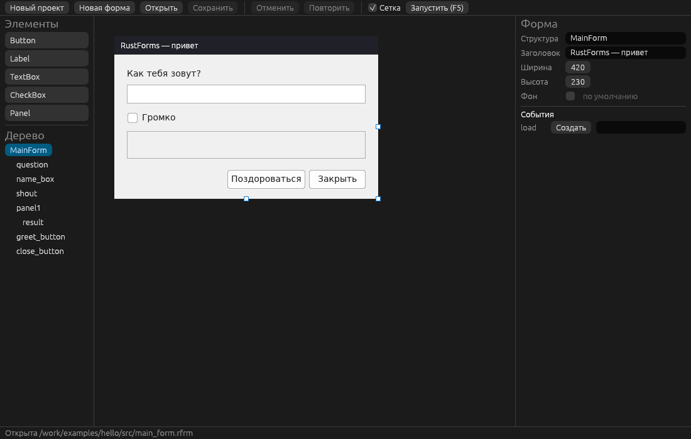
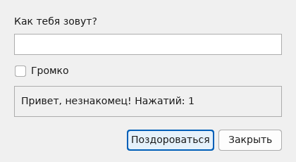
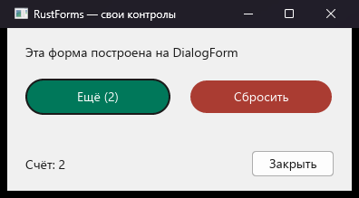
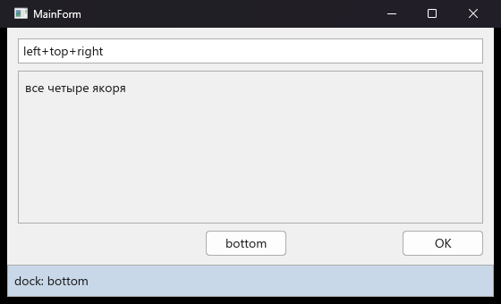
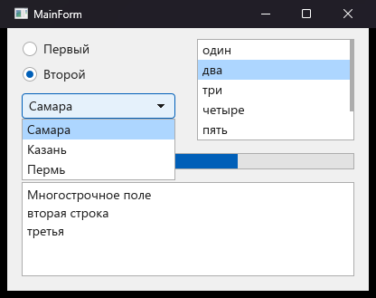
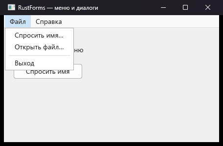
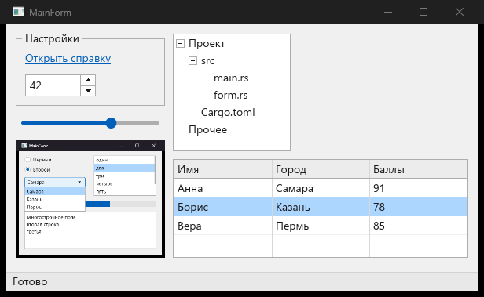

# RustForms

**«WinForms на Rust»**: окна и контролы, визуальный дизайнер форм с двойным кликом по кнопке, плагины для RustRover и Visual Studio. Один и тот же вид на разных ОС — контролы рисует сама библиотека.

```rust
fn button1_click(&mut self, _ui: &mut Ui, _e: &ClickArgs) {
    self.text_box1.set_text("Привет!");
}
```



> Проект на ранней стадии: API ещё меняется.

## Возможности

- **Контролы:** `Button`, `Label`, `TextBox` (однострочный, с выделением и буфером обмена), `CheckBox`, `RadioButton`, `ComboBox`, `ListBox`, `ProgressBar`, `MenuStrip`, `Panel`, `GroupBox`, `LinkLabel`, `NumericUpDown`, `TrackBar`, `PictureBox`, `StatusStrip`, `DataGridView`, `TreeView`, `TabControl` с `TabPage`, `DateTimePicker`, `SplitContainer`, `ToolStrip`; компонент `Timer`; поле ввода бывает многострочным.
- **События:** `load`, `click`, `text_changed`, `checked_changed`, `selected_changed`, `item_clicked`, `value_changed`, `tick`, `cell_changed`, `context_item_clicked`, события мыши, клавиатуры и фокуса, `closing` и `resize` формы; обработчики — обычные методы формы.
- **Размещение:** якоря и Dock, как в WinForms.
- **Свойства:** цвета, размер и жирность шрифта, выравнивание, подсказки, порядок Tab.
- **Окна:** главное меню, системные сообщения и выбор файлов, несколько форм и диалоги.
- **Свои контролы** на базе готовых и **производные формы**.
- **Дизайнер:** перетаскивание, сетка, свойства, отмена и повтор, копирование, двойной клик создаёт обработчик.
- **Плагины IDE:** форма открывается вкладкой, элементы и свойства — в боковых окнах самой IDE.

| | |
|---|---|
|  |  |
|  |  |
|  |  |

## Платформы

| ОС | Состояние |
|---|---|
| Windows 11 | основная, проверяется |
| Linux (Debian 13, X11) | сборка, тесты, окна, клавиатура и буфер обмена проверены в контейнере |
| macOS (Apple Silicon) | проходит `cargo check`, на настоящем Mac **не запускалось** |

Wayland отдельно не проверялся. Скрипты сборки плагинов написаны для Windows.

## Быстрый старт

Нужен Rust 1.88 или новее (проверено на 1.97).

```bash
git clone https://github.com/anomal3/RustForms.git
cd RustForms
cargo run -p hello                  # пример приложения
cargo run -p custom                 # свои контролы и производная форма
cargo run -p dialogs                # меню, диалоги и вторая форма
cargo run -p rustforms-designer     # дизайнер
```

Новый проект — кнопкой **«Новый проект»** в дизайнере или командой:

```bash
cargo run -p rustforms-designer -- project путь/к/MyApp
```

Созданный проект ссылается на библиотеку **по пути** к этому репозиторию (на crates.io она не опубликована).

На Linux для сборки понадобятся пакеты разработки X11 и fontconfig (в Debian: `libx11-dev libfontconfig1-dev pkg-config`), для запуска — `libxkbcommon-x11-0 libxcursor1 libxrandr2 libxi6`.

## Как устроена форма

На каждую форму три файла:

| Файл | Что в нём | Кто пишет |
|---|---|---|
| `main_form.rfrm` | описание формы (TOML), главный источник | дизайнер |
| `main_form.designer.rs` | структура формы с контролами и подписки | генератор, **не редактировать** |
| `main_form.rs` | ваши данные и обработчики | вы; дизайнер только дописывает заготовки |

```rust
use rustforms::prelude::*;

#[path = "main_form.designer.rs"]
mod designer;

pub use designer::MainForm;     // структуру создаёт дизайнер

/// Свои данные формы: в обработчиках доступны как `self.data`.
#[derive(Default)]
pub struct Data {
    clicks: u32,
}

impl MainForm {
    fn button1_click(&mut self, ui: &mut Ui, _e: &ClickArgs) {
        self.data.clicks += 1;
        self.label1.set_text(format!("Нажатий: {}", self.data.clicks));
        self.text_box1.set_text(self.label1.text());
        ui.title = "Готово".into();     // ui — то, что относится к окну
    }
}
```

```rust
// main.rs
mod main_form;

fn main() -> Result<(), rustforms::RunError> {
    rustforms::run(main_form::MainForm::create())
}
```

### Отличия от C#

| WinForms | RustForms |
|---|---|
| `textBox1.Text = "x";` | `self.text_box1.set_text("x");` |
| `var s = textBox1.Text;` | `let s = self.text_box1.text();` |
| `button1.Enabled = false;` | `self.button1.set_enabled(false);` |
| `this.Text = "Заголовок";` | `ui.title = "Заголовок".into();` |
| `Close();` | `ui.close();` |

- Изменение свойства из кода **не вызывает событие**.
- Добавить контрол во время работы нельзя: набор контролов задан структурой формы.
- Имена `data` и `create` заняты сгенерированным кодом.

## Списки и прочие контролы

```rust
self.combo_box1.set_items(["Самара", "Казань"]);
self.combo_box1.set_selected_index(Some(0));
let city = self.combo_box1.selected_text();      // Option<&str>

self.progress_bar1.set_value(60);                // диапазон по умолчанию 0..100
self.text_box1.set_multiline(true);
```

- Радиокнопки одного родителя (формы или панели) образуют группу.
- `set_checked` и `set_selected_index` из кода не вызывают события и не снимают отметки с соседних радиокнопок.

## Таблица, дерево, картинка

```rust
self.data_grid_view1.set_columns(["Имя", "Город"]);
self.data_grid_view1.add_row(["Анна", "Самара"]);
let row = self.data_grid_view1.selected_row();          // Option<&[String]>

self.tree_view1.set_items(["Проект/src/main.rs", "Проект/Cargo.toml"]);
self.tree_view1.expand_all();

self.picture_box1.load("photo.png")?;                    // только PNG
self.track_bar1.set_range(0, 10);
```

Щелчок по заголовку сортирует строки, границы столбцов тянутся мышью. Картинка, указанная у `PictureBox` в дизайнере, вшивается в программу.

## Дата, разделитель, панель инструментов, меню правой кнопки

```rust
self.date_time_picker1.set_value(Date::new(2026, 11, 26));   // e.text в событии: "2026-11-26"
self.data_grid_view1.set_editable(true);
self.list_box1.set_context_menu(["Удалить", "-", "Очистить"]);

fn list_box1_context_item_clicked(&mut self, _ui: &mut Ui, e: &MenuItemArgs) {
    if e.item == "Очистить" {
        self.list_box1.clear();
    }
}
```

- Правка ячейки: повторный щелчок по выбранной, Enter или просто набор; Enter сохраняет, Escape отменяет.
- Разделитель `SplitContainer` двигается мышью в программе; в дизайнере — свойством.
- `ToolStrip` — кнопки-надписи, щелчок даёт `item_clicked`.
- У поля ввода меню «Вырезать / Копировать / Вставить» есть сразу.
- `Date::today()` считает по UTC.

## Вкладки и таймер

`TabControl` содержит страницы `TabPage`, контролы кладутся в страницы. В дизайнере щелчок по ярлычку переключает страницу, новую страницу добавляет элемент `TabPage` из Toolbox.

```rust
self.tab_control1.set_selected_index(1);

self.timer1.set_interval_ms(500);
self.timer1.start();

fn timer1_tick(&mut self, _ui: &mut Ui, _e: &TickArgs) {
    self.data.seconds += 1;
}
```

`Timer` — не контрол: в программе его не видно, в дизайнере он показан значком.

## Свойства и события контролов

```rust
self.title.set_font_size(20.0);
self.title.set_bold(true);
self.title.set_fore_color(Color::ACCENT);
self.save.set_tooltip("Сохранить файл");
self.password.set_password(true);

fn name_box_key_down(&mut self, ui: &mut Ui, e: &KeyArgs) {
    if e.key == "Enter" {           // имя по месту клавиши, не зависит от раскладки
        ui.accept();
    }
}

fn main_form_closing(&mut self, ui: &mut Ui, e: &ClosingArgs) {
    if !ui.confirm("Выход", "Закрыть без сохранения?") {
        e.cancel();                 // окно останется открытым
    }
}
```

У каждого контрола есть `double_click`, `mouse_enter`, `mouse_leave`, `mouse_down`, `mouse_up`; у принимающих фокус — ещё `key_down`, `key_up`, `got_focus`, `lost_focus`.

## Меню, диалоги и вторая форма

```rust
fn menu_item_clicked(&mut self, ui: &mut Ui, e: &MenuItemArgs) {
    match e.item.as_str() {
        "Файл/Открыть" => {
            if let Some(path) = ui.open_file(&[("Текст", &["txt", "md"])]) {
                self.result.set_text(path.display().to_string());
            }
        }
        "Файл/Выход" if ui.confirm("Выход", "Закрыть программу?") => ui.close(),
        "Справка/О программе" => ui.message_box("О программе", "RustForms"),
        _ => {}
    }
}
```

Пункты меню задаются строками `"Меню/Пункт"` или `"Меню/Подменю/Пункт"`, `"Меню/-"` — разделитель. Ещё есть `ui.save_file(..)` и `ui.pick_folder()`.

Вторая форма — как `ShowDialog`, но обработчик **не ждёт** закрытия: что делать потом, задаётся замыканием.

```rust
ui.show_dialog(NameForm::create(), |me: &mut MainForm, dialog: &mut NameForm, ok, _ui| {
    if ok {                                      // в диалоге вызвали ui.accept()
        me.result.set_text(dialog.name_box.text());
    }
});

ui.show(NameForm::create());                     // обычное немодальное окно
```

На Linux системные окна идут через `xdg-desktop-portal` (выбор файлов) и `zenity` (сообщения); там они **не проверялись**.

Закрытие главного окна завершает программу. Полный пример: [`examples/dialogs`](examples/dialogs/src).

## Якоря и Dock

```rust
self.ok.set_anchor(Anchor::RIGHT | Anchor::BOTTOM);   // держаться правого нижнего угла
self.body.set_dock(Dock::Fill);                       // занять всё свободное место
```

Те же свойства есть в дизайнере, и при растягивании формы в нём привязанные контролы двигаются. Прижатые (`Dock`) контролы размещаются по порядку добавления: первый оказывается у самого края.

## Свои контролы

Вместо наследования — поле с пометкой `#[base]`: всё, что не переопределено, достаётся от него.

```rust
use rustforms::prelude::*;

#[derive(Control)]
pub struct RoundButton {
    #[base]
    base: Button,          // клик, клавиатура и text() — от кнопки
    pub color: Color,
}

impl ControlImpl for RoundButton {
    fn on_paint(&mut self, p: &mut Painter) {
        let area = p.area();
        p.fill_round_rect(area, area.height / 2.0, self.color);
        p.text(self.base.text(), area, Color::WHITE, Align::Center, 0.0);
    }
}
```

Отличие от C#: если код родителя вызывает собственный метод, переопределение во внешней структуре не срабатывает.

Чтобы использовать свой контрол в дизайнере, укажите в свойстве **«Свой тип»** путь к нему (например `crate::round_button::RoundButton`). Тип должен реализовывать `Default`; в дизайнере он показывается видом базового контрола.

Базовая форма подключается через `View::include` — вместе с контролами и обработчиками. Пример целиком: [`examples/custom`](examples/custom/src).

## Дизайнер

Три способа пользоваться, формат один:

- отдельная программа `rustforms-designer [форма.rfrm]`;
- плагин RustRover;
- расширение Visual Studio.

Из командной строки:

```text
rustforms-designer project <папка>                      новый проект
rustforms-designer new <папка> <ИмяФормы>               новая форма
rustforms-designer generate <форма.rfrm>                пересоздать designer.rs
rustforms-designer handler <форма.rfrm> [контрол] [событие]   создать обработчик, напечатать файл:строка
rustforms-designer serve <форма.rfrm>                   фоновый режим для плагинов (JSON по строке)
```

## Плагин RustRover

**Готовый плагин** для Windows лежит в [релизах](https://github.com/anomal3/RustForms/releases): дизайнер уже внутри, собирать ничего не нужно. Новые проекты в этом случае берут библиотеку из репозитория по тегу, поэтому нужен доступ к нему и установленный `git`.

Собрать самому:

```powershell
.\plugins\rustrover\build.ps1 -Ide "C:\путь\к\RustRover"
```

Нужна только папка самой IDE (используются её JDK и библиотеки, Gradle не нужен). Проверялся на RustRover 2026.3. Результат — `plugins\rustrover\build\rustforms-rustrover.zip`.

Установка: **Settings → Plugins → ⚙ → Install Plugin from Disk…**, затем **OK** и перезапуск IDE.

- Новый проект: **File → New → Project… → RustForms**.
- Форма открывается вкладкой **Designer**; окна **RustForms Toolbox** и **RustForms Properties**.
- Двойной клик по контролу создаёт обработчик и переходит к нему.

## Расширение Visual Studio

```powershell
.\plugins\visualstudio\build.ps1
```

Нужна Visual Studio с компонентом «Разработка расширений». Результат — `plugins\visualstudio\bin\Release\net472\RustForms.VisualStudio.vsix`; устанавливается двойным кликом при закрытой VS.

Форма открывается вкладкой документа, элементы лежат в стандартном **Toolbox**, свойства — в окне **Properties**.

**Статус: экспериментальный.** Открытие формы, Toolbox и Properties проверены в Visual Studio 2026 (Insiders); перетаскивание, клавиши и команды меню — нет. Подсказки по Rust в Visual Studio требуют стороннего расширения.

Оба скрипта записывают в плагин путь к собранному дизайнеру, поэтому плагин собирают на той машине, где им пользуются.

## Структура репозитория

```text
crates/rustforms            библиотека: окно, контролы, события, отрисовка, якоря
crates/rustforms-macros     #[derive(Control)]
crates/rustforms-model      формат .rfrm, генератор кода, вставка обработчиков
crates/rustforms-designer   дизайнер: окно и режим serve
plugins/rustrover           плагин RustRover (Java)
plugins/visualstudio        расширение Visual Studio (C#)
examples/                   hello, custom, dialogs
```

Проверка: `cargo test` и `cargo clippy --all-targets`.

Внутри: `winit` (окна), `tiny-skia` и `softbuffer` (рисование), `cosmic-text` (текст), `egui` (панели отдельного дизайнера).

## Чего пока нет

- Свободный ввод в `ComboBox`, перенос по словам в многострочном поле, выбор нескольких строк, таблицы и деревья.
- Значки и горячие клавиши меню, контекстное меню, панель инструментов.
- Стили и темы, привязка данных, разметка в духе XAML.
- Ввод через IME (китайский, японский), доступность для экранных дикторов.
- Мигание курсора и контекстное меню в поле ввода.
- Выделение нескольких контролов в дизайнере.
